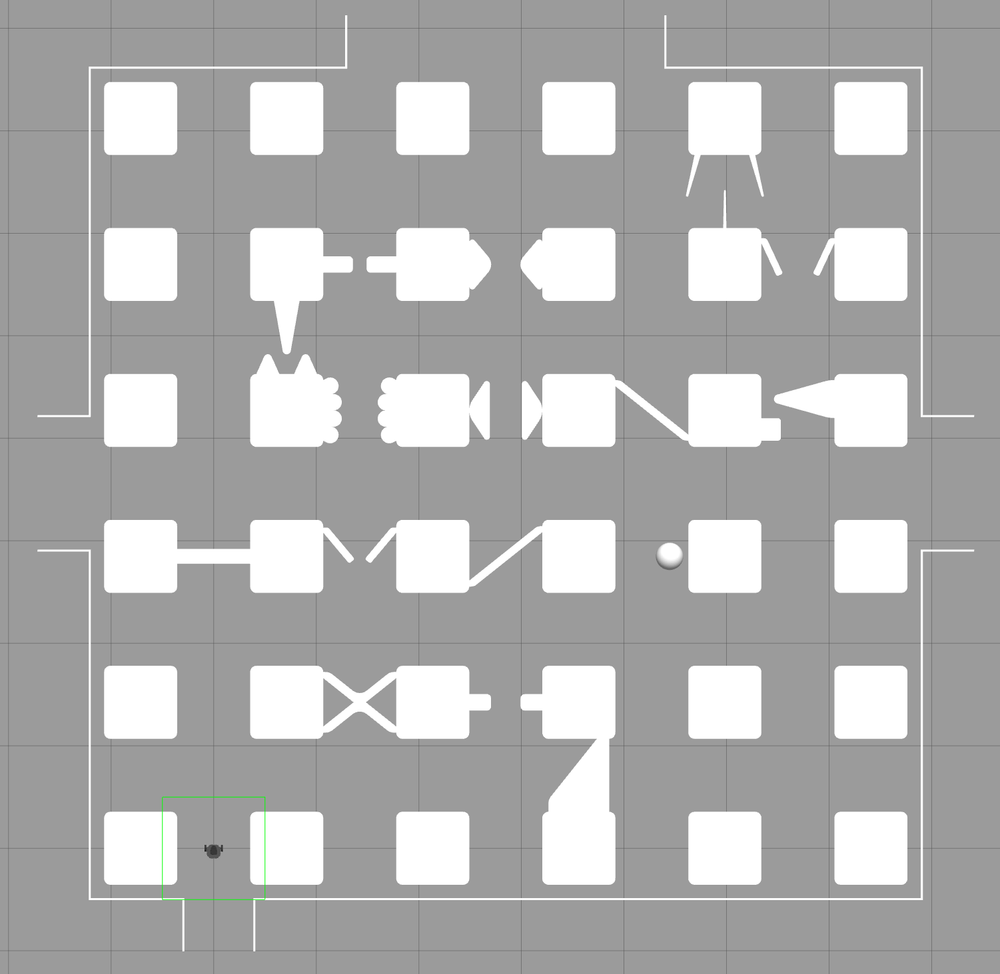
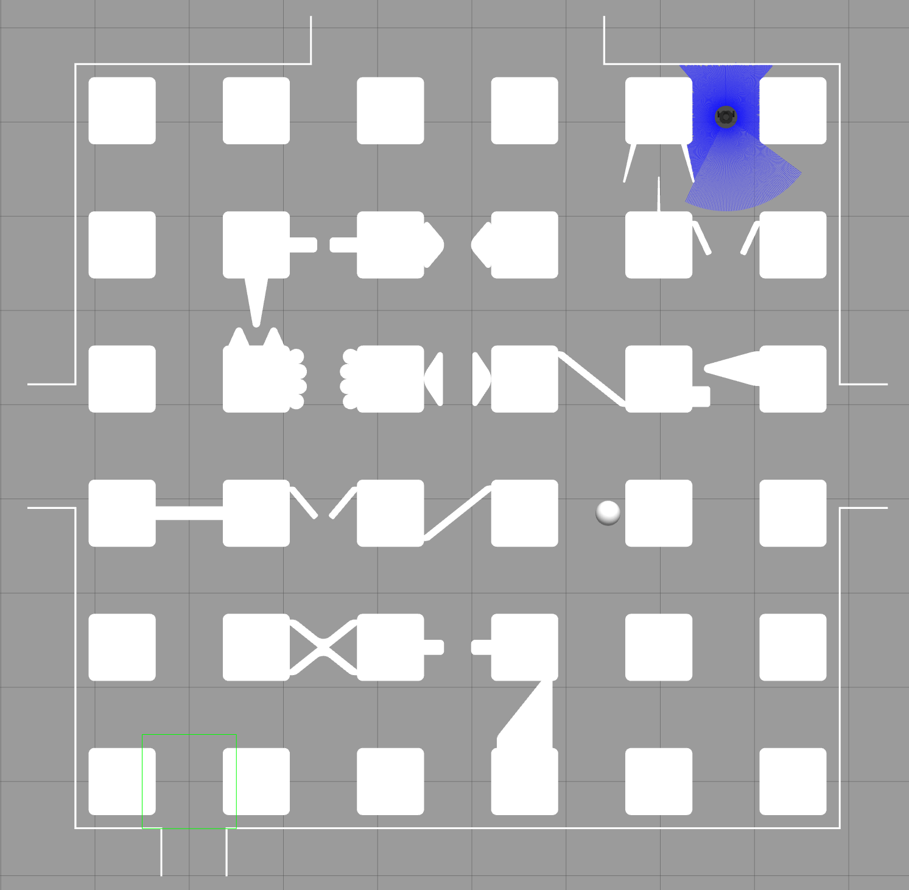
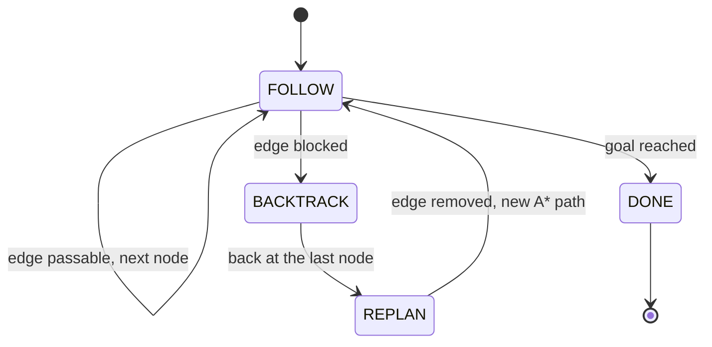
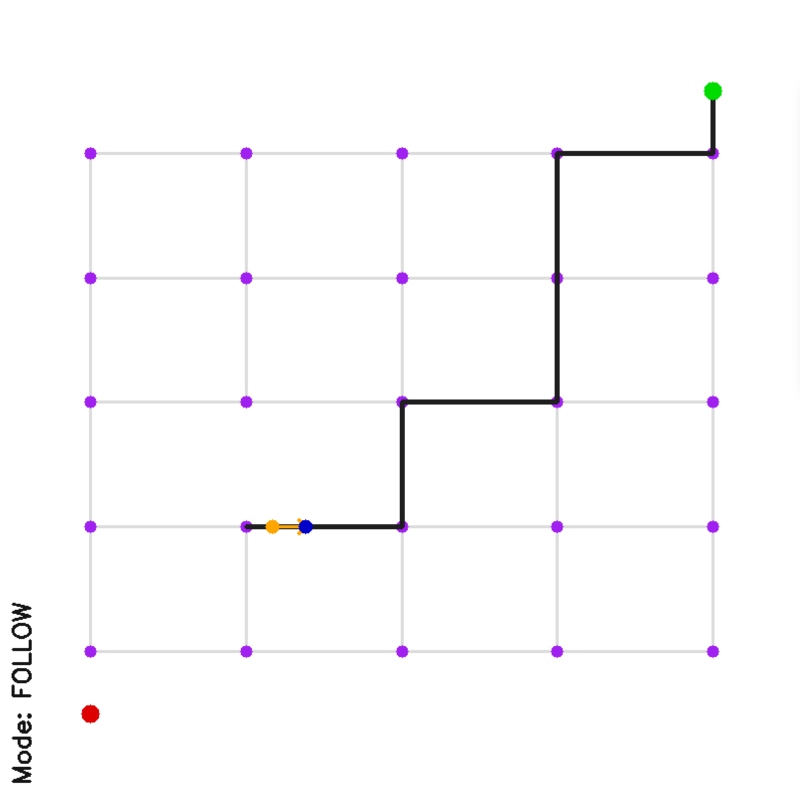
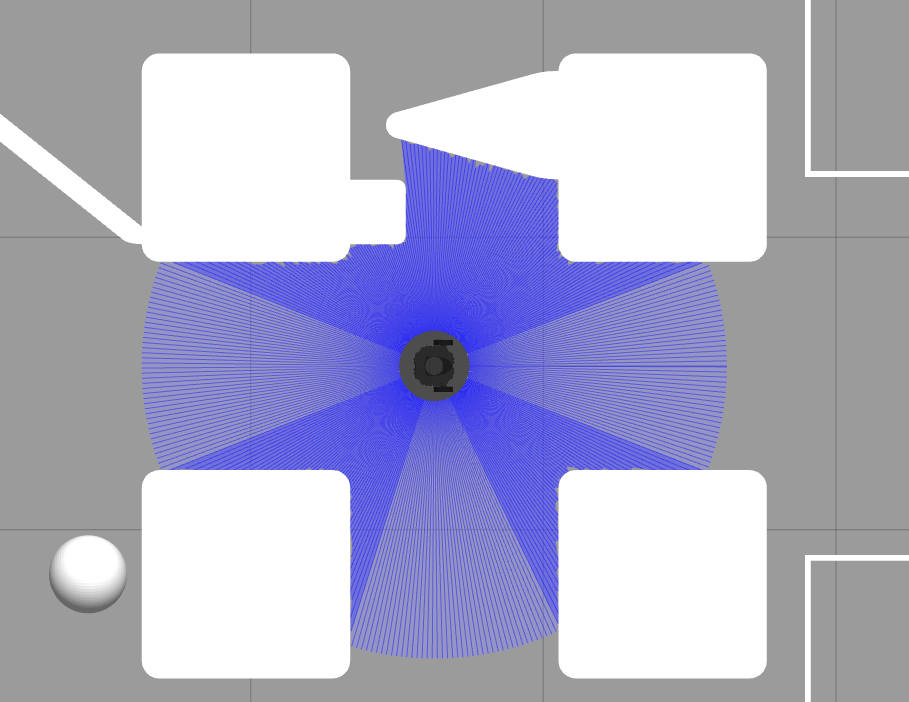
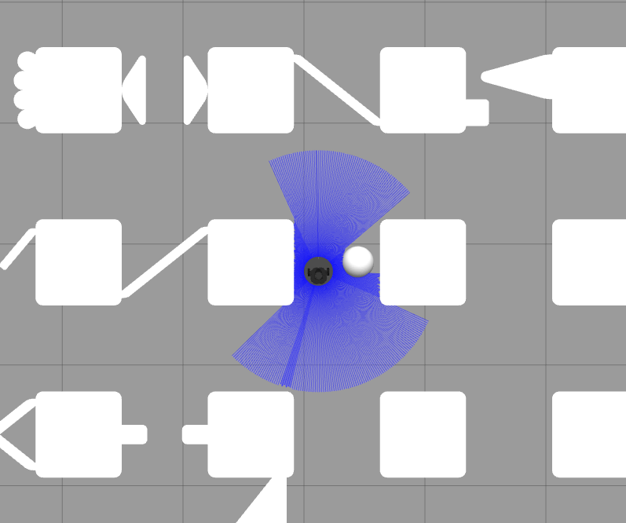

# Maze navigation with a TurtleBot3 (ROS 2 · Gazebo)


A ROS 2 Python node that drives a **TurtleBot3 Burger** through a maze in Gazebo, from the entrance to the goal, **without touching any wall**. Some passages between the nodes of the maze are blocked: the robot detects them with its **LiDAR**, goes back, and finds a new route with **A\***.

| | |
|---|---|
| **Course** | MEC-E5012 Vehicle Mechatronics: Control – Project Work |
| **University** | Aalto University, Autumn 2026 |
| **Authors** | Nicola Gaiotto, Andrea Cevenini |
| **Stack** | ROS 2 Humble, Gazebo Classic 11, Python (NumPy, OpenCV) |

<p align="center">
  
</p>

[vmc2_simulation_video.webm](https://github.com/user-attachments/assets/d33bd5e6-80e1-488e-9a0f-f94e778c9925)


---

## Results

Full run on the maze with obstacles (simulation time read from Gazebo):

| Metric | Result |
|---|---|
| Time from start to goal | **126 s** of simulation time (limit 150 s) |
| Blocked edges detected | **5 / 5** |
| Runs without wall contact | **3 / 3** |
| Narrowest passage | **0.31 m** free gap for a 0.178 m wide robot |

Free gaps measured by the robot itself during the run (from the node log):

| Passage | Free gap measured | Decision |
|---|---|---|
| Open corridors | 0.65 – 0.70 m | passable |
| Ball, one side free | 0.39 m | passable, target shifted to the free side |
| Two diagonal bars | 0.32 m | passable |
| Two triangles | 0.31 m | passable |
| 5 blocked edges | no gap ≥ 0.198 m | blocked → backtrack and replan |

<p align="center">
  
</p>

---

## How it works

The navigation pipeline follows the framework given by the course: **perception** decides whether the next edge of the node graph is passable, **path planning** computes the route with A* and updates it when an edge is blocked, and **control** drives the robot along the planned edges.

### Navigation modes



- **FOLLOW** – drive one edge at a time and check it with the LiDAR.
- **BACKTRACK** – return to the last visited node.
- **REPLAN** – remove the blocked edge from the graph and run A* again from that node.
- **DONE** – goal reached, robot stopped.

### Path planning

The maze is a 5 × 5 graph of nodes (25 nodes, 40 edges). `plan_from` connects the robot position and the goal to their nearest nodes and runs the A* search provided by the template (Euclidean heuristic), producing the list of waypoints `start → nodes … → goal`. Every time an edge turns out to be blocked it is removed from the graph, so the next A* call routes around it. In the full run the robot removes 5 edges and drives about 21 m.

<p align="center">
  
  <br><em>Live view: node graph, A* path (black), robot (orange) and pursuit target (blue).</em>
</p>

### Perception – is the next edge passable?

The LiDAR has 360 beams and only **1 m** of range, so from a node the robot never sees the next node, but it does see the obstacle, which is always in the middle of the edge.

1. **Edge frame.** Every LiDAR point is transformed into the world frame using the odometry, and then into the frame of the current edge: distance along the edge and lateral offset from it.
2. **Free gaps.** The points between the robot and the next node are projected onto the lateral axis; the empty intervals between them are the free gaps.
3. **Decision.** The edge is passable if there is a gap of at least **0.178 m + 2 × 0.01 m = 0.198 m** (robot width plus 1 cm per side). Among the wide-enough gaps the one closest to the edge axis is chosen: space hidden behind an obstacle is never taken for a gap.

To make the decision robust: an edge is declared blocked only after **3 consecutive** blocked scans, scans are ignored while the robot turns fast (scan and odometry are not synchronised), and the decision is taken in the **first 0.3 m** of the edge, where the whole edge is already in view.

<p align="center">
  
</p>

### Control – pure pursuit along the current edge

- **Target:** a point **0.3 m ahead on the current edge only** (never on the next one, so the robot does not cut corners and reaches every node), shifted sideways to the centre of the free gap. The shift is low-pass filtered and fades out near the node.
- **Turning in place:** if the heading error is larger than **17°** the robot rotates on the spot with a proportional controller (kp = 3).
- **Pure pursuit:** otherwise it follows the arc through the target, with curvature 2y/L², so ω = v · 2y / L², and v = min(0.22, 2L) m/s to stop accurately at the nodes.
- **Limits:** v ≤ 0.22 m/s and ω ≤ 2.84 rad/s, the TurtleBot3 Burger limits.

<p align="center">
  
  <br><em>Passing the ball: only one side of the edge is free, so the target is shifted towards it.</em>
</p>

### What we implemented

The course provided a template (`navigator.py`) with the graph, the A* search, the main control loop and the visualisation. We implemented:

| Part | Function / block |
|---|---|
| Parameters | look-ahead distance, velocity limits, PID gains, perception thresholds |
| Path planning | `plan_from` |
| Perception | `is_passable`, plus the helpers `segment_scan` and `free_gap` |
| Obstacle avoidance | `obstacle_avoided_target` |
| Control | `turtlebot_control` |
| Navigation logic | the FOLLOW, BACKTRACK and REPLAN blocks of `control_step` |

The solution contains **no map-specific information**: no coordinates of the maze or of the obstacles, only the robot dimensions, the LiDAR data and the given node graph.

---

## Repository structure

```
turtlebot3-maze-navigation/
├── vmc2_project/                  # ROS 2 package (ament_cmake)
│   ├── src/navigator.py           # navigation node (our implementation)
│   ├── launch/                    # Gazebo world + TurtleBot3 spawn
│   ├── worlds/                    # maze with / without obstacles
│   ├── models/turtlebot3_burger/  # robot model (LiDAR range 1 m)
│   ├── CMakeLists.txt
│   └── package.xml
├── docs/
│   ├── images/                    # screenshots used in this README
│   └── media/                     # demo video
├── LICENSE
└── README.md
```

---

## Getting started

### Requirements

- Ubuntu 22.04, ROS 2 Humble, Gazebo Classic 11
- `gazebo_ros_pkgs` and `turtlebot3_gazebo`
- Python packages: `numpy`, `opencv-python` (or `python3-opencv`)
- The maze models `project_track` and `project_track_no_obs`, provided by the course (not included in this repository)

### Build

```bash
# 1. maze models (from the course material)
mkdir -p ~/.gazebo/models
unzip project_track.zip -d ~/.gazebo/models/
unzip project_track_no_obs.zip -d ~/.gazebo/models/

# 2. package in a ROS 2 workspace
cp -r vmc2_project ~/ros2_ws/src/
cd ~/ros2_ws
colcon build --symlink-install --packages-select vmc2_project
source install/setup.bash
export TURTLEBOT3_MODEL=burger
```

### Run

```bash
# terminal 1 – Gazebo with the maze
ros2 launch vmc2_project project.launch.py

# terminal 2 – navigation node
ros2 run vmc2_project navigator.py --ros-args -p use_sim_time:=true
```

The world (with or without obstacles) is selected in `launch/project.launch.py`. A second window, *Grid A\* Path Follower*, shows the graph, the planned path and the robot in real time.

To start from another node, teleport the robot (for example to checkpoint 1) and set `self.start_pos` in `navigator.py` to the same coordinates:

```bash
ros2 service call /set_entity_state gazebo_msgs/srv/SetEntityState "{state: {name: 'burger', pose: {position: {x: 3.560, y: -4.272, z: 0.0}, orientation: {x: 0.0, y: 0.0, z: 0.0, w: 1.0}}, reference_frame: 'world'}}"
```

### Main parameters

| Parameter | Value | Meaning |
|---|---|---|
| `lookahead_dist` | 0.3 m | distance of the pursuit target along the edge |
| `v_max`, `w_max` | 0.22 m/s, 2.84 rad/s | TurtleBot3 Burger limits |
| `align_tol` | 0.3 rad (≈ 17°) | heading error above which the robot turns in place |
| `robot_width`, `gap_margin` | 0.178 m, 0.01 m | minimum passable gap = 0.198 m |
| `blocked_scans` | 3 | consecutive blocked scans to declare an edge blocked |
| `commit_dist` | 0.3 m | distance after which the decision on an edge is kept |

---

## Possible extensions

- Plan a weaving path through S-shaped passages (the course's bonus obstacle is currently treated as blocked).
- Keep moving through nodes where the path goes straight, instead of stopping at every node.

---

## Acknowledgements

- Template of `navigator.py`, launch files, worlds and maze models: course staff of MEC-E5012 Vehicle Mechatronics: Control, Aalto University.
- TurtleBot3 model and launch files: ROBOTIS Co., Ltd. and Open Source Robotics Foundation (Apache-2.0).

## License

Released under the [Apache License 2.0](LICENSE), the same license as the original ROS 2 package.
